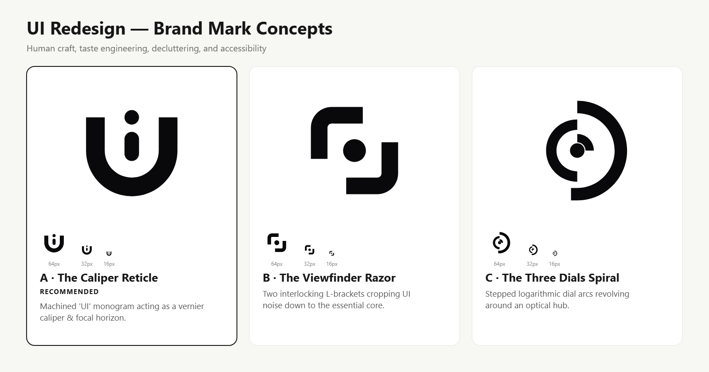

<div align="center">


# UI Redesign

**Human Craft, Taste Engineering, Decluttering & Accessibility Engine for AI Coding Agents**

[](./CHANGELOG.md)
[](./references/rule-catalog.md)
[](./references/harness.md)
[](./references/taste-engineering.md)

</div>

---

## Overview

`ui-redesign` is a disciplined, gate-enforced skill that audits and rebuilds web interfaces. Rather than defaulting to generic LLM clichés (purple glows, unchunked card stacks, raw drop shadows, and em-dash marketing fluff), it grounds every change in:

1. **The Project Design Contract**: Strict adherence to the repository's `DESIGN.md` and semantic tokens.
2. **Taste Engineering**: Calibration via Three Dials, brief inference, and aesthetic archetypes ([`references/taste-engineering.md`](./references/taste-engineering.md)).
3. **Human Design Laws**: Miller's chunking, Gulf of Execution, Gulf of Evaluation, and Gestalt proximity.
4. **Hardened Engineering**: Zero layout shift, full WCAG 2.2 AA accessibility, scroll containment, and zero mutation or hook race conditions.

---

## Identity & Logo Concepts

This skill was branded using the companion `logo-design` skill. Three distinct geometric directions were crafted to capture the essence of interface transformation:

<div align="center">



</div>

- **Direction A: The Caliper Reticle (Recommended)**: An architectural monogram merging `U` and `I`. The outer concentric vessel forms a caliper level that cradles a central precision needle and optical focal lens.
- **Direction B: The Viewfinder Razor**: Two interlocking L-framing brackets that crop out visual clutter, isolating the essential task-driven core.
- **Direction C: The Three Dials Spiral**: Three concentric stepped logarithmic dial arcs that visualize the tuning of variance, motion, and density.

---

## Taste Engineering & The Three Dials

Interface decisions are calibrated through three numerical dials (1 to 10) defined in [`references/taste-engineering.md`](./references/taste-engineering.md):

```
                        THE THREE DIALS
 ┌───────────────────────┬───────────────────────┬───────────────────────┐
 │   DESIGN_VARIANCE     │   MOTION_INTENSITY    │    VISUAL_DENSITY     │
 │       (1 – 10)        │       (1 – 10)        │       (1 – 10)        │
 ├───────────────────────┼───────────────────────┼───────────────────────┤
 │ 1–3: Rigid 12-col grid│ 1–3: Static micro-feel│ 1–3: Gallery airy     │
 │ 4–7: Offset asymmetry │ 4–7: Fluid transitions│ 4–7: Balanced SaaS    │
 │ 8–10: Expressive flow │ 8–10: Kinetic physics │ 8–10: Cockpit dense   │
 └───────────────────────┴───────────────────────┴───────────────────────┘
```

### The Mandatory "Design Read"
Before writing styling code, the agent infers and declares:
> *"Reading this as: `<page kind>` for `<audience>`, with a `<vibe>` language, leaning toward `<design system or archetype>`."*

### System Archetypes
- **Official Enterprise / B2B**: High density, border hairlines over cards, tabular monospace figures.
- **Craft / Editorial**: Distinctive typographic pairing, tight leading, deliberate surface elevation tiers.
- **Minimalist**: High restraint, borders doing the work, zero gratuitous badges or gradients.
- **Brutalist**: Raw borders, high contrast, intentional typography.
- **Soft**: Deep concentric Doppelrand containers, delicate luminance steps, organic radii.

---

## The 6-Gate Audit Pipeline

Every audit writes proof-of-work documents to `.ui-audit/<surface-slug>/`. A phase cannot begin until the preceding gate passes.

```
 [Phase 0] Scope ────────► Gate G0 (Verbatim request & mode recorded)
     │
 [Phase 1] Research ─────► Gate G1 (100% files read + strict sequential rule audit)
     │
 [Phase 2] Plan ─────────► Gate G2 (Wireframes + every finding mapped to a slice)
     │
 [Phase 3] Approval ─────► Gate G3 (User explicit approval recorded in PLAN.md)
     │
 [Phase 4] Implement ────► Gate G4 (Verified slice-by-slice commits with test output)
     │
 [Phase 5] Verify ───────► Gate G5 (Zero open findings, clean typecheck, tests pass)
```

### Audit Modes
- **FULL**: Used for complete screen redesigns or new feature builds. Evaluates all 312 rules across 26 categories in strict sequential order (`LAY-01` through `AI-06`).
- **FOCUSED**: Used for targeted fixes. Audits 100% of the rules within the mapped categories, logging out-of-scope issues without editing them.

---

## Catalog Overview (312 Rules · 26 Categories)

Detailed criteria and code examples are cataloged in [`references/rule-catalog.md`](./references/rule-catalog.md):

| Code | Domain | Key Requirements | Reference Guide |
|---|---|---|---|
| **LAY** | Layout & Declutter | Display wrap caps, hero viewport limits, no cards-in-cards, bento density | [`hierarchy-declutter.md`](./references/hierarchy-declutter.md) |
| **HIE** | Visual Hierarchy | Single focal anchor, surface luminance tiers, aligned baselines | [`hierarchy-declutter.md`](./references/hierarchy-declutter.md) |
| **RSP** | Responsive & Fluid | No overflow 320–1920px, text wrapping, safe-area insets, container queries | [`responsive-fluid.md`](./references/responsive-fluid.md) |
| **DLG** | Dialogs & Overlays | Focus traps, escape keys, scroll lock shift prevention, mobile sheets | [`responsive-fluid.md`](./references/responsive-fluid.md) |
| **STA** | States & First-Run | Empty states with recovery actions, first-run checklists, post-delete navigation | [`loading-states.md`](./references/loading-states.md) |
| **LDG** | Loading & Skeletons | Skeletons matching redesigned UI, button spinners preventing layout jumps | [`loading-states.md`](./references/loading-states.md) |
| **PAG** | Pagination & Lists | Server-side boundaries, URL filter syncing, aggregate parity | [`pagination.md`](./references/pagination.md) |
| **TAB** | Data Tables | Numeric right-alignment, opaque sticky headers, persistent row actions | [`tables-data-grids.md`](./references/tables-data-grids.md) |
| **MUT** | Mutations | Double-submit guards, optimistic rollback, cache invalidation | [`mutations-forms.md`](./references/mutations-forms.md) |
| **FRM** | Forms & Inputs | Visible labels, accessible validation, paste preservation, submit safety | [`mutations-forms.md`](./references/mutations-forms.md) |
| **UPL** | File Uploads | Window drop containment, input resets, determinate progress bars | [`file-uploads.md`](./references/file-uploads.md) |
| **ERR** | Error Handling | Actionable user messages, persistent error codes, offline retry queues | [`mutations-forms.md`](./references/mutations-forms.md) |
| **NOT** | Notifications & Alerts | Sticky critical alerts, hover pauses on undo, deduplicated batch toasts | [`notifications-toasts.md`](./references/notifications-toasts.md) |
| **HOOK**| React Hooks | Exhaustive deps, fetch cancellation, zero stale closures, no object churn | [`react-hooks.md`](./references/react-hooks.md) |
| **A11Y**| Accessibility | 4.5:1 contrast, native buttons, visible focus rings, full keyboard traversal | [`accessibility.md`](./references/accessibility.md) |
| **NAV** | Navigation & Palette | Command palette states, search debounce aborts, instant clear controls | [`responsive-fluid.md`](./references/responsive-fluid.md) |
| **CON** | Consistency | Single primitive variant, Page Theme Lock, Color Consistency Lock | [`consistency.md`](./references/consistency.md) |
| **CPY** | UX Copy & Voice | Absolute zero em-dash ban, middle-dot rationing, no meta-numbering | [`ux-copy.md`](./references/ux-copy.md) |
| **SLOP**| Anti-Slop | Eyebrow pill rationing, no fake screenshot divs, no placeholder avatars | [`craft.md`](./references/craft.md) |
| **MOT** | Motion Dynamics | Motivated entrance, budgeted duration (≤250ms), raw scroll listener ban | [`motion.md`](./references/motion.md) |
| **SOUL**| Soulful Craft | Doppelrand radius math, active press depression, button wrap prevention | [`craft.md`](./references/craft.md) |
| **HUM** | Human Laws | Cognitive limits (7 items), Gulf of Execution, calm peripheral awareness | [`craft.md`](./references/craft.md) |
| **PERF**| Performance | Interaction latency budgets, table virtualization, layout containment | [`tables-data-grids.md`](./references/tables-data-grids.md) |
| **I18N**| Internationalization | Flexible container budgets, untranslated token guards, date localization | [`ux-copy.md`](./references/ux-copy.md) |
| **THM** | Themes & Dark Mode | Elevation parity through luminance, contrast verification across modes | [`craft.md`](./references/craft.md) |
| **AI**  | AI Interfaces | Streaming tokens + stop, cited sources, contextual uncertainty | [`ai-ux.md`](./references/ai-ux.md) |

---

## Repository Map

```
.agents/skills/ui-redesign/
├── SKILL.md                          # Primary agent router (strictly <= 100 lines)
├── README.md                         # Architecture overview, logo showcase, and index
├── CHANGELOG.md                      # Complete version history and provenance
├── assets/logo/                      # Generated logo concepts, SVG masters, and renders
│   ├── concept-a-caliper.svg         # The Caliper Reticle (Recommended)
│   ├── concept-b-aperture.svg        # The Viewfinder Razor
│   ├── concept-c-dials.svg           # The Three Dials Spiral
│   └── concepts.png                  # Unified concept review board
├── references/
│   ├── taste-engineering.md          # Three Dials, brief inference, GSAP motion, archetypes
│   ├── rule-catalog.md               # 312 auditable rule IDs with exact failure conditions
│   ├── harness.md                    # Ledger protocol, gate criteria G0..G5, proof rules
│   ├── static-audit.md               # File-by-file pass, cross-file checks, grep recipes
│   ├── plan-template.md              # PLAN.md template with declutter table & wireframes
│   ├── phases.md                     # Step-by-step instructions for Phases 0 through 5
│   ├── craft.md                      # Anti-slop, human cognitive laws, and soulful finish
│   ├── hierarchy-declutter.md        # Focal hierarchy, whitespace pacing, and layout rhythm
│   ├── responsive-fluid.md           # Breakpoint ergonomics and scroll containment (§9)
│   ├── motion.md                     # Micro-feedback, state transitions, and GSAP hygiene
│   ├── ux-copy.md                    # Voice, microcopy, punctuation, and middle-dot rules
│   ├── consistency.md                # System-wide reuse and theme/color locks
│   ├── loading-states.md             # Skeletons, empty states, and first-run checklists
│   ├── mutations-forms.md            # Write mechanics, form safety, and error handling
│   ├── tables-data-grids.md          # Data table alignment, sticky headers, row actions
│   ├── file-uploads.md               # Drop containment, previews, and batch progress
│   ├── notifications-toasts.md       # Alert permanence, pause triggers, and batching
│   ├── react-hooks.md                # React 19 hook safety, stale closure eradication
│   ├── accessibility.md              # WCAG 2.2 AA checklists, keyboard traversal, ARIA
│   ├── ai-ux.md                      # Streaming UX, factual citations, and confirmation
│   ├── design-md.md                  # Reading and digesting project design specifications
│   ├── pagination.md                 # Pagination contracts, URL state, cursor mechanics
│   └── updating-skill.md             # Self-maintenance guidelines and verification tests
└── scripts/
    ├── scan_patterns.mjs             # Candidate discovery scanner
    └── ui_audit.mjs                  # Playwright runtime audit engine
```

---

## Usage

Trigger this skill whenever designing, reviewing, or redesigning frontend surfaces:

```bash
# Redesign an entire view (FULL mode)
/ui-redesign Redesign the invoices page to match our updated DESIGN.md

# Targeted UX/A11y fixes (FOCUSED mode)
/ui-redesign Fix mobile sheet overflow and missing pending states on the checkout form
```
